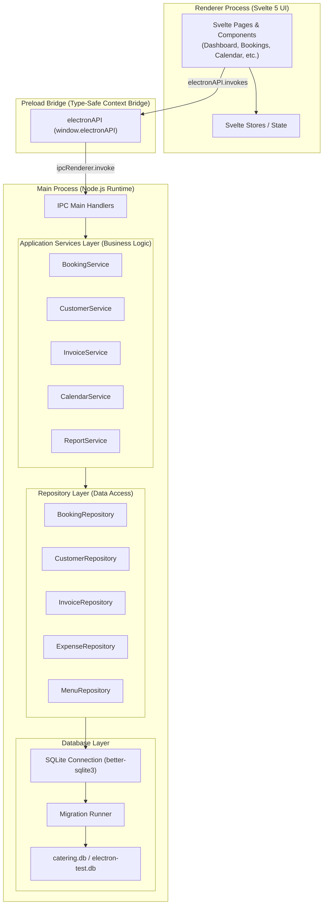
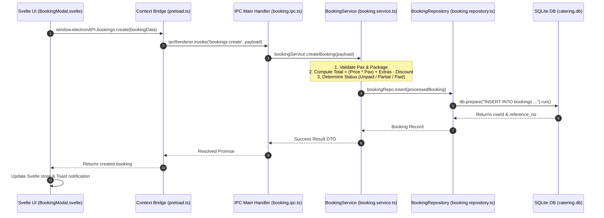

# System Architecture — Jayraldine's Catering Electron App

> **Architecture Spec:** Electron + Svelte 5 + TypeScript + Vite + SQLite (`better-sqlite3`)  
> **Target Application:** Jayraldine's Catering Management System (v5.0.0)

---

## 1. High-Level Architecture Overview

The system follows a strict **Layered Architecture Pattern** to separate UI rendering, IPC communication, business domain logic, data access, and persistence.



---

## 2. Layer Responsibilities & Design Rules

### Rule #1: Zero Business Logic or Direct SQL in UI Components
> 🚫 **BAD:** Writing SQL queries, financial calculations, or raw DB updates inside `.svelte` files.  
> ✅ **GOOD:** Components call `window.electronAPI.bookings.create(data)` and render state returned by services.

| Layer | Technologies | Responsibilities | Forbidden Patterns |
|---|---|---|---|
| **1. UI Layer (Renderer)** | Svelte 5, HTML5, CSS3, Tailwind/Vanilla | User interface rendering, form validation UX, local component state, event dispatching. | ❌ Direct SQL execution, raw file system access, financial formulas. |
| **2. IPC Bridge Layer** | Electron `contextBridge`, `ipcRenderer` | Type-safe bridge exposing validated APIs to window object via TypeScript definitions. | ❌ Exposing raw Node `child_process` or `fs` primitives directly to renderer. |
| **3. IPC Handler Layer** | `ipcMain.handle()` | Receives IPC requests, unpacks DTO payloads, delegates calls to Application Services, catches errors. | ❌ Heavy domain logic or direct SQL queries inside IPC route definitions. |
| **4. Services Layer** | TypeScript Application Services | **Core Business Rules:** Downpayment calculations, balance remaining, calendar load thresholds, state transitions (`PENDING` $\rightarrow$ `CONFIRMED`). | ❌ Direct UI rendering code or raw SQLite query string building. |
| **5. Repository Layer** | TypeScript Repositories | Prepared SQL statement execution, object relational mapping, table CRUD, transaction management. | ❌ Financial business logic decisions or UI state management. |
| **6. Database Layer** | SQLite (`better-sqlite3`), Migration Engine | Schema migrations (`schema_version`), table creation, indexes, foreign key enforcement, WAL mode. | ❌ Unindexed full table scans or unversioned schema modifications. |

---

## 3. Data Flow Example: Creating a Booking



---

## 4. Directory & Module Blueprint

```
src/
├── main/                           # Main Process (Node.js Runtime)
│   ├── index.ts                    # Electron App entry point & window manager
│   ├── ipc/                        # IPC Route Handlers
│   │   ├── booking.ipc.ts
│   │   ├── customer.ipc.ts
│   │   ├── invoice.ipc.ts
│   │   └── system.ipc.ts
│   ├── services/                   # Application Business Services
│   │   ├── booking.service.ts
│   │   ├── customer.service.ts
│   │   ├── invoice.service.ts
│   │   └── report.service.ts
│   ├── repositories/               # Repository Data Access Objects
│   │   ├── booking.repository.ts
│   │   ├── customer.repository.ts
│   │   ├── invoice.repository.ts
│   │   └── expense.repository.ts
│   └── database/                   # SQLite Engine & Migrations
│       ├── connection.ts           # better-sqlite3 singleton
│       ├── migration-runner.ts     # Automatic migration executor
│       └── migrations/             # SQL Migration Scripts
│           ├── 001_initial_schema.sql
│           └── 002_add_updated_at.sql
│
├── preload/                        # Preload Scripts
│   ├── index.ts                    # contextBridge exposure
│   └── types.ts                    # ElectronAPI TypeScript interfaces
│
└── renderer/                       # Renderer Process (Svelte 5 Application)
    ├── index.html                  # HTML Shell
    ├── src/
    │   ├── main.ts                 # Svelte mount
    │   ├── App.svelte              # Application layout & navigation router
    │   ├── lib/
    │   │   ├── components/         # Reusable Svelte UI components
    │   │   │   ├── Sidebar.svelte
    │   │   │   ├── Topbar.svelte
    │   │   │   └── KpiCard.svelte
    │   │   ├── pages/              # Primary Screen Views
    │   │   │   ├── Dashboard.svelte
    │   │   │   ├── Bookings.svelte
    │   │   │   ├── Calendar.svelte
    │   │   │   ├── Customers.svelte
    │   │   │   ├── Packages.svelte
    │   │   │   ├── Expenses.svelte
    │   │   │   ├── Reports.svelte
    │   │   │   └── Settings.svelte
    │   │   └── stores/             # Svelte Reactive Stores
    │   │       ├── bookingStore.ts
    │   │       └── themeStore.ts
    └── vite.config.ts              # Vite Bundler configuration
```
