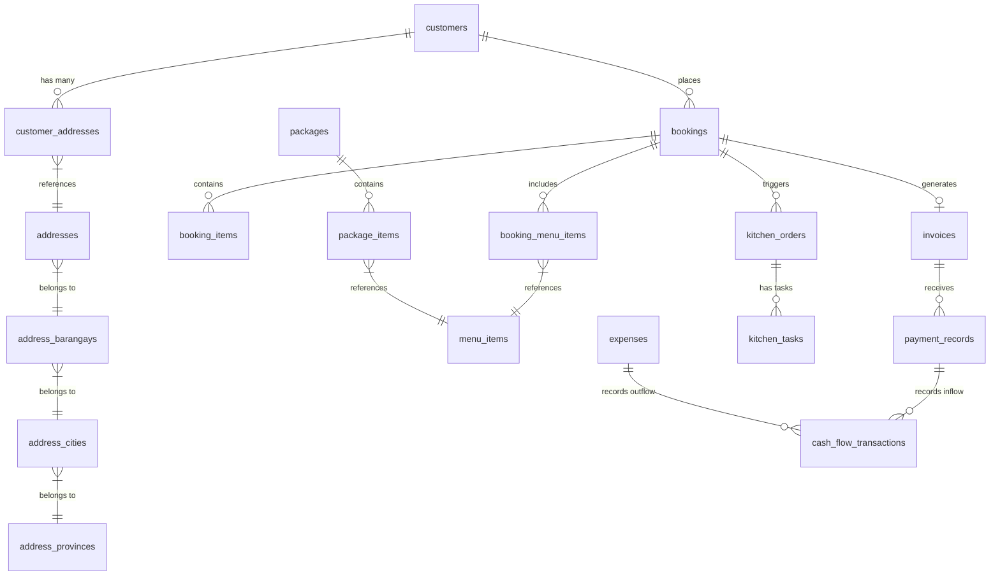

# Database Entity Relationships — Jayraldine's Catering System

> **Freeze Version:** v4.0.6 (Database Relationship & Entity Blueprint)  
> **Database File:** `catering.db`  

This document outlines all entity relationships, foreign key constraints, join hierarchies, and cardinality across the 28 tables of the database to guide the Electron migration.

---

## 1. High-Level Entity Relationship Diagram (Mermaid)

---

## 2. Detailed Entity Relationships & Cardinality

### 2.1 Customer & Address Hierarchy
- **`customers` (1) $\rightarrow$ (N) `customer_addresses`**
  - **Foreign Key:** `customer_addresses.ca_customer_id` $\rightarrow$ `customers.cus_id`
  - **Cardinality:** 1 Customer has Many Addresses.
- **`customer_addresses` (N) $\rightarrow$ (1) `addresses`**
  - **Foreign Key:** `customer_addresses.ca_address_id` $\rightarrow$ `addresses.addr_id`
  - **Cardinality:** Junction table mapping customers to specific street address records.
- **`addresses` (N) $\rightarrow$ (1) `address_barangays`**
  - **Foreign Key:** `addresses.addr_barangay_id` $\rightarrow$ `address_barangays.ab_id`
  - **Cardinality:** Address belongs to 1 Barangay.
- **`address_barangays` (N) $\rightarrow$ (1) `address_cities`**
  - **Foreign Key:** `address_barangays.ab_city_id` $\rightarrow$ `address_cities.ac_id`
  - **Cardinality:** Barangay belongs to 1 City / Municipality.
- **`address_cities` (N) $\rightarrow$ (1) `address_provinces`**
  - **Foreign Key:** `address_cities.ac_province_id` $\rightarrow$ `address_provinces.ap_id`
  - **Cardinality:** City belongs to 1 Province (e.g. Cebu).

---

### 2.2 Booking & Order Core Pipeline
- **`customers` (1) $\rightarrow$ (N) `bookings`**
  - **Foreign Key:** `bookings.bk_customer_id` $\rightarrow$ `customers.cus_id`
  - **Cardinality:** 1 Customer places 0, 1, or Many Bookings.
- **`bookings` (1) $\rightarrow$ (N) `booking_items`**
  - **Foreign Key:** `booking_items.bi_booking_id` $\rightarrow$ `bookings.bk_id`
  - **Cardinality:** 1 Booking has Many line items / custom charges.
- **`bookings` (1) $\rightarrow$ (N) `booking_menu_items`**
  - **Foreign Key:** `booking_menu_items.bmi_booking_id` $\rightarrow$ `bookings.bk_id`
  - **Cardinality:** 1 Booking has Many Menu Items/dishes selected.
- **`booking_menu_items` (N) $\rightarrow$ (1) `menu_items`**
  - **Foreign Key:** `booking_menu_items.bmi_item_id` $\rightarrow$ `menu_items.mi_id`
  - **Cardinality:** Junction mapping menu items/dishes to bookings.

---

### 2.3 Financial, Billing & Invoicing Pipeline
- **`bookings` (1) $\rightarrow$ (1) `invoices`**
  - **Foreign Key:** `invoices.inv_booking_id` $\rightarrow$ `bookings.bk_id`
  - **Cardinality:** 1 Booking generates 1 Invoice (`inv_invoice_ref`).
- **`invoices` (1) $\rightarrow$ (N) `payment_records`**
  - **Foreign Key:** `payment_records.pr_invoice_id` $\rightarrow$ `invoices.inv_id`
  - **Cardinality:** 1 Invoice receives 0, 1, or Many Payment Records (Down Payment, Installments, Final Payment).

---

### 2.4 Menu & Package Bundles
- **`packages` (1) $\rightarrow$ (N) `package_items`**
  - **Foreign Key:** `package_items.pi_package_id` $\rightarrow$ `packages.pkg_id`
  - **Cardinality:** 1 Catering Package contains Many default Package Items.
- **`package_items` (N) $\rightarrow$ (1) `menu_items`**
  - **Foreign Key:** `package_items.pi_menu_item_id` $\rightarrow$ `menu_items.mi_id`
  - **Cardinality:** Package items reference master menu items.

---

### 2.5 Kitchen Operations Pipeline
- **`bookings` (1) $\rightarrow$ (1) `kitchen_orders`**
  - **Foreign Key:** `kitchen_orders.ko_booking_id` $\rightarrow$ `bookings.bk_id`
  - **Cardinality:** 1 Confirmed Booking triggers 1 Kitchen Order ticket.
- **`kitchen_orders` (1) $\rightarrow$ (N) `kitchen_tasks`**
  - **Foreign Key:** `kitchen_tasks.kt_order_id` $\rightarrow$ `kitchen_orders.ko_id`
  - **Cardinality:** 1 Kitchen Order ticket has Many prep checklist tasks (`kt_is_done`).

---

## 3. Key Cascade & Soft-Delete Guidelines for Migration

1. **Deleting a Booking:**
   - Soft-delete or update status to `CANCELLED` in `bookings`.
   - Update `invoices` status to `Cancelled`.
   - Associated `kitchen_orders` should be marked `Cancelled` or archived.
2. **Deleting a Customer:**
   - Must check if customer has active `bookings`. If active bookings exist, block hard-delete to maintain database foreign key integrity.
3. **Menu Item Deletion:**
   - If a `menu_item` is referenced in past `booking_menu_items`, flag `mi_status = 'Archived'` or `Out of Stock` instead of `DELETE FROM menu_items` to preserve historical order reports.
